# ZERO FLARE — FLAME EVIDENCE LAB

**AI-first scientific research platform over NASA microgravity combustion evidence.**

Counts in this README are generated from [docs/data-audit/release-manifest.json](docs/data-audit/release-manifest.json) — the single source of truth (research doc §8.1).
ZERO FLARE Mission Team · NASA Space Apps 2026 — *Flame in Freefall*
Targeting **Best Use of Science** and **Best Use of Data**.
Research copilot: **CIR-1** (42 typed tools, citations, inspectable traces).

| | |
|---|---|
| **Live deployment** | Cloudflare Workers — **https://zero-flare-lab.yousuf-aways.workers.dev** |
| **Release gate** | `GET /api/selftest` — deterministic scientific self-test (equations, gate, facility engine, persistence) |
| **Open data** | `GET /corpus/README.md` — immutable, SHA-256-verified corpus mirror served from the edge |
| **Submission kit** | `docs/SUBMISSION_FORM_CONTENT.md` (form text) · `docs/ZERO_FLARE_UIUX_Walkthrough.docx` (16-screenshot UI/UX guide) |

A researcher chooses a mission environment, explores authentic experiments, equipment and
source-linked data, asks CIR-1 to retrieve evidence, gate comparisons for comparability,
choose equations, perform validated calculations, generate data-backed visualizations, run a
deterministic fire-safety facility analysis, evaluate applicable models — and save/export a
reproducible evidence packet from My Work.

> Research decision support only — **not** a certified spacecraft fire-protection system.
> Official mission-specific emergency procedures always take precedence.

## Quick start

```bash
npm install          # install dependencies
npm run dev          # http://localhost:3000 — full platform, JSONL persistence
npm run build:cf     # build the Cloudflare Worker (OpenNext) — includes corpus mirror
npm run cf:migrate   # apply the D1 schema (remote) — workspace persistence on the edge
npm run deploy:cf    # deploy to Cloudflare Workers (same name/domain: zero-flare-lab)
```

Environment variables (all optional — the platform degrades honestly):

| Variable | Purpose |
|---|---|
| `AI_API_KEY` / `AI_PROVIDER=gemini` | CIR-1 synthesis via Google Gemini (free tier) |
| `LLM_BASE_URL` + `LLM_API_KEY` + `LLM_MODEL` | any OpenAI-compatible provider (Groq / Z.ai / …) |
| *(none)* | on Cloudflare, the **Workers AI binding** powers CIR-1 with zero keys; locally, deterministic mode |

## The sections (merged IA — one integrated research environment)

| Section | What lives there |
|---|---|
| **Mission** | Earth–ISS–Moon–Mars 3D journey, destination atmospheres (flight-proven vs concept), evidence coverage, ranked findings, authentic NASA media, ZERO FLARE brand identity |
| **Investigations** | 24 NASA PSI investigation workspaces embedding EDA over real recovered tables, equipment, media, equations, typed mini-graph, documented gaps |
| **Compare** | **Comparability gate first** (gravity/scale/hardware/outcome audit — "not directly comparable" states exactly why), then condition matrices, typed graph slices, gap discovery |
| **Scenarios** | Unified fire-safety assistant: Prevention → Detection → Prediction → Suppression with the deterministic facility engine (six visible drivers), verified calculators, guarded model playgrounds |
| **3D Lab** | Equipment catalogue with fidelity labels; six schematic apparatus reconstructions (never official CAD) **plus official NASA ISS and Perseverance GLB assets with full provenance** |
| **Data & Sources** | Batched server ingestion pipeline (SHA-256 dedup, quarantine, receipts, audit gating), SHA-256 recovery ledger, honest historical-batch status, source registry, media catalogue |
| **My Work** | Saved items, gap shelf, research sessions, evidence-packet export (provenance + limitations included) |
| **Research Tools** (grouped) | Model Studio, Variable Dictionary, Equation Registry, Diagnostics & Reconciliation |
| **CIR-1** (global dock) | Context-aware research copilot — every view, every selection |

`Ctrl+K` opens command search (sections, 24 investigations, 63 equations, environments). Deep links: `#investigation/PSI-69`, `#compare`, `#scenarios/suppression`.

## Screenshots (from the shipped build — `docs/screenshots/`)

| Mission — landing & evidence base | Investigations — 24 PSI workspaces |
|---|---|
| 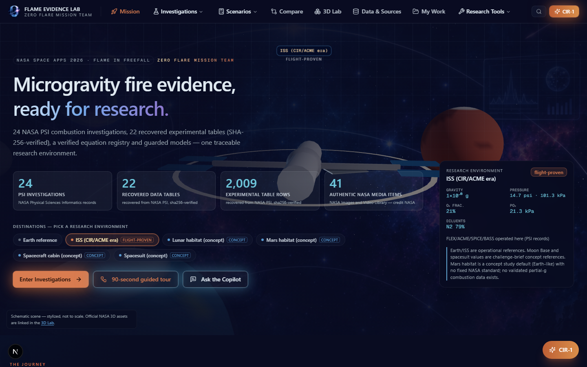 | 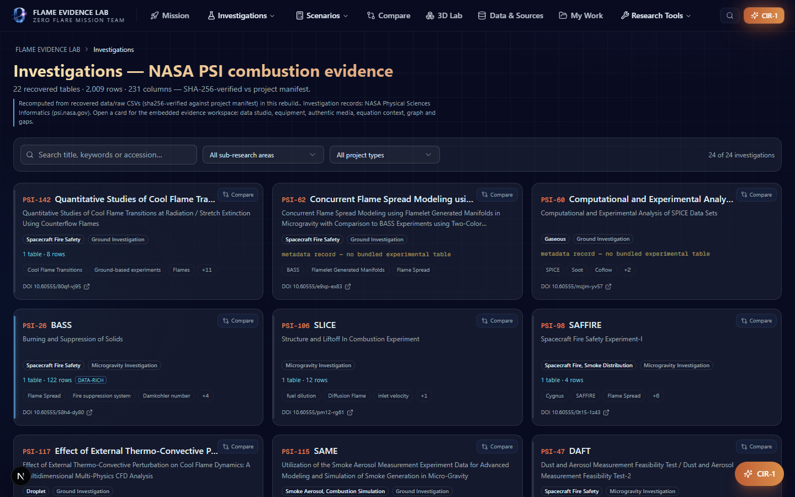 |

| Investigation detail workspace | Compare — comparability gate |
|---|---|
| 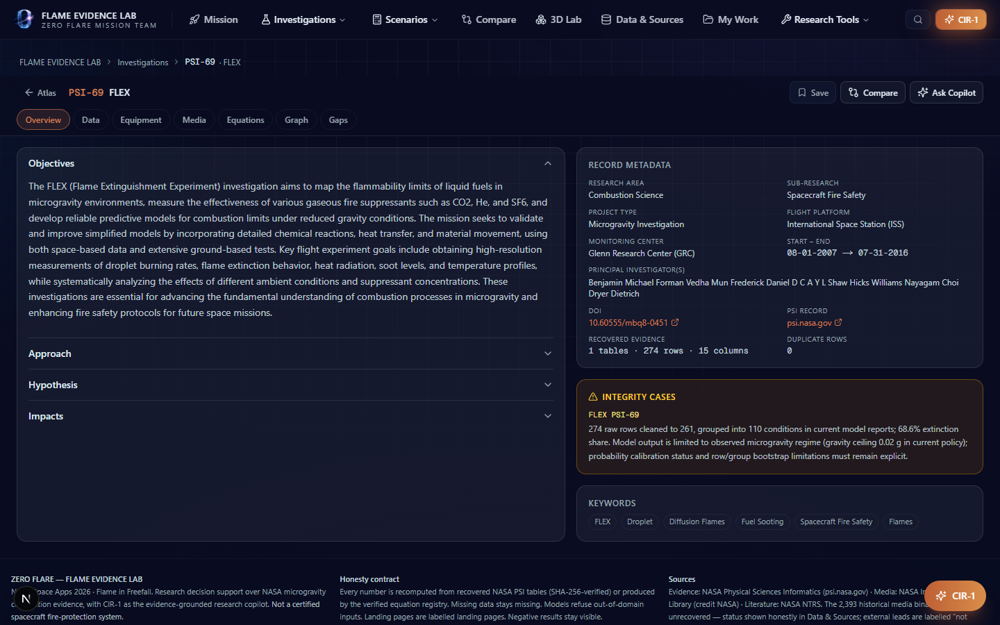 | 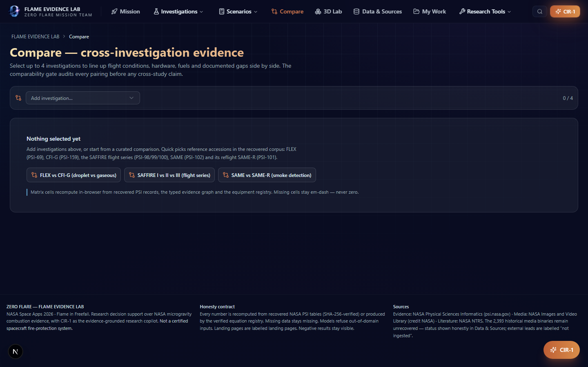 |

| Scenarios — fire-safety lifecycle | 3D Lab — honest fidelity labels |
|---|---|
| 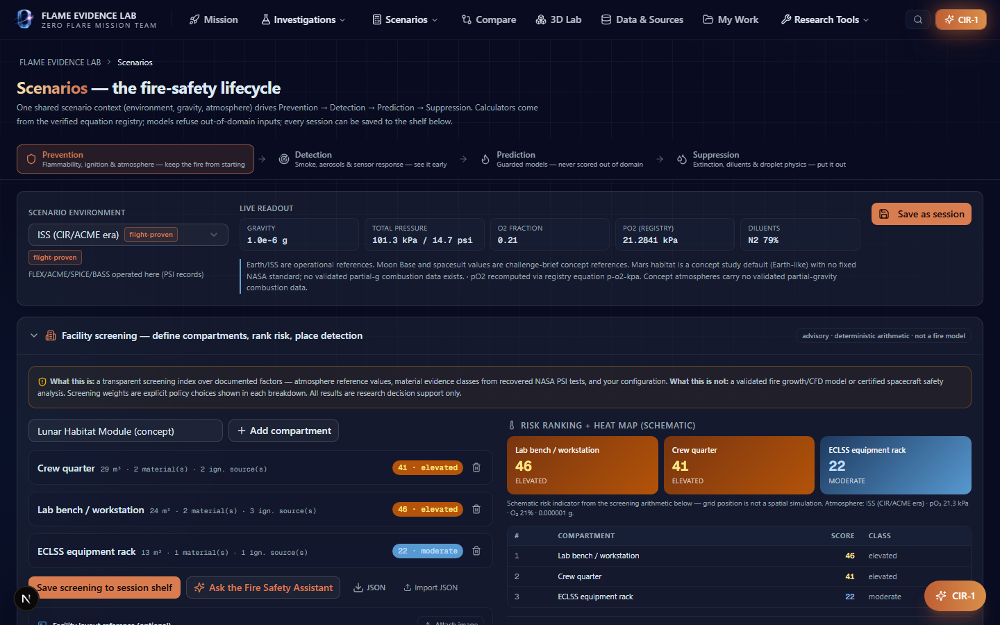 | 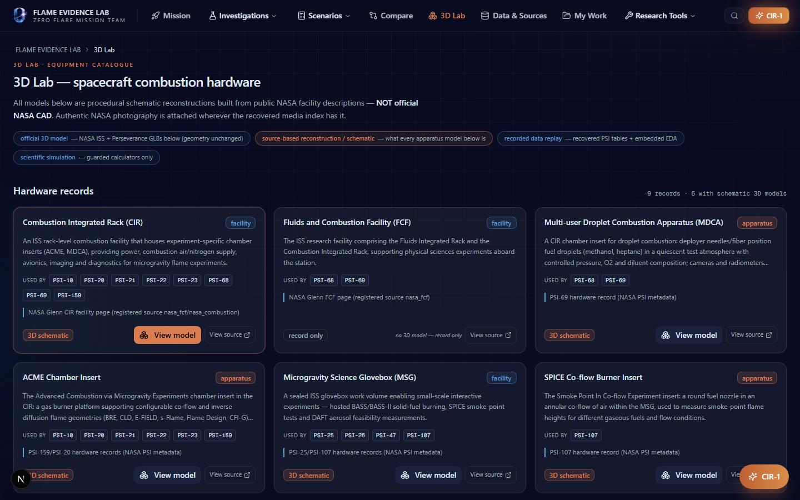 |

| Data & Sources — SHA-256 ledger | My Work — evidence packets |
|---|---|
| 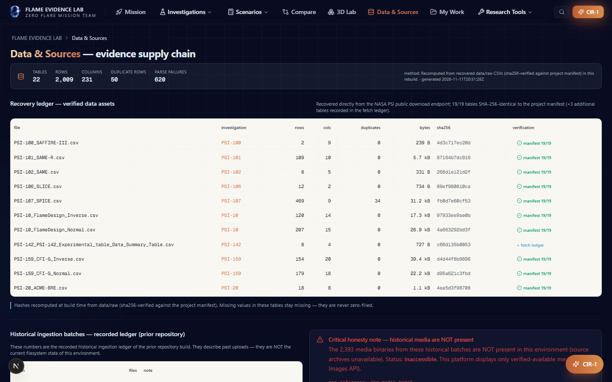 | 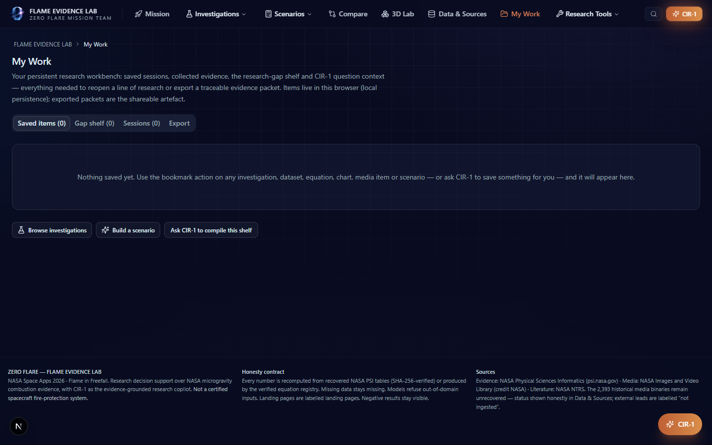 |

| CIR-1 — deterministic AI copilot | Evidence coverage map — the partial-gravity gap |
|---|---|
| 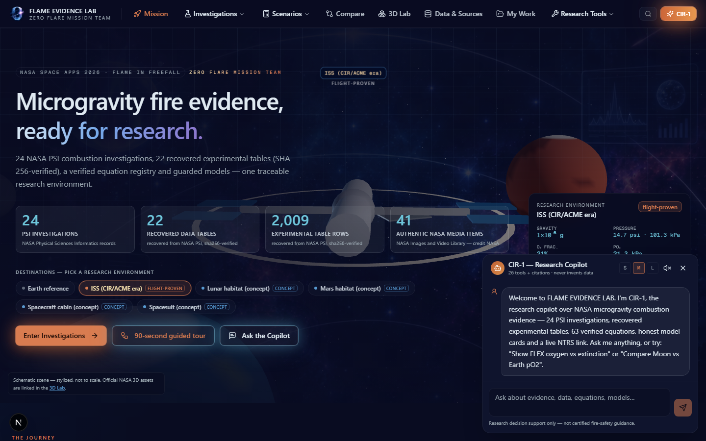 | 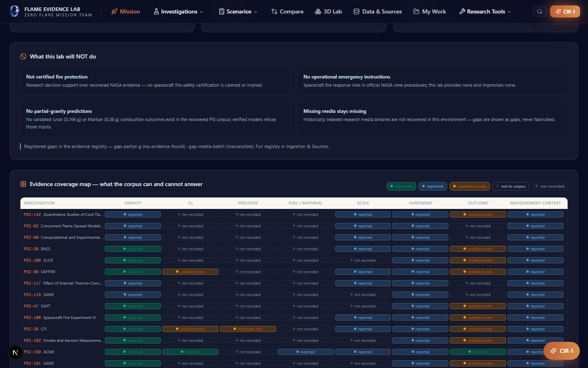 |

| Guided demo — step 1 | Guided demo — copilot step |
|---|---|
| 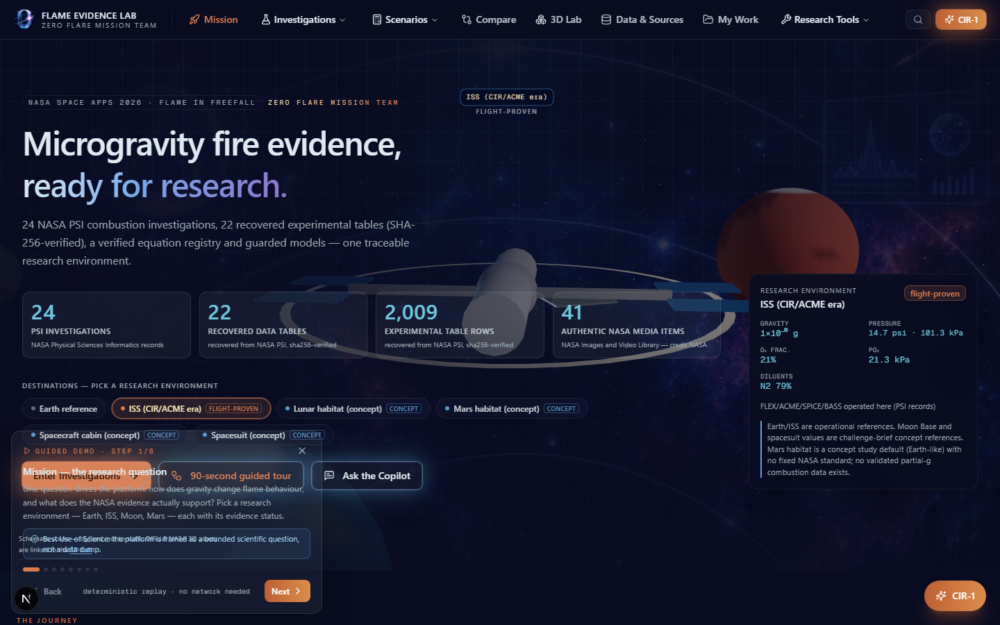 | 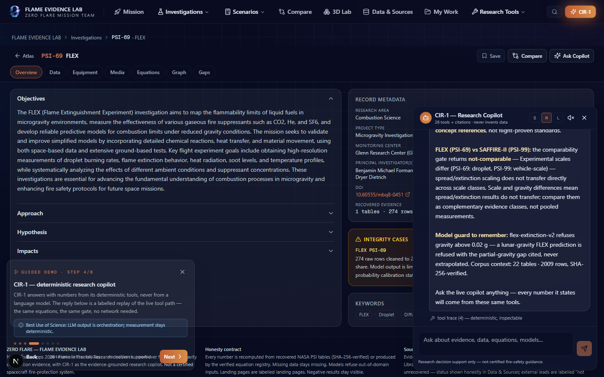 |

**Fully responsive** — verified at 1440 / 768 / 390 px:

| Mission 768 px | Scenarios 768 px | Mission 390 px | Investigations 390 px |
|---|---|---|---|
| 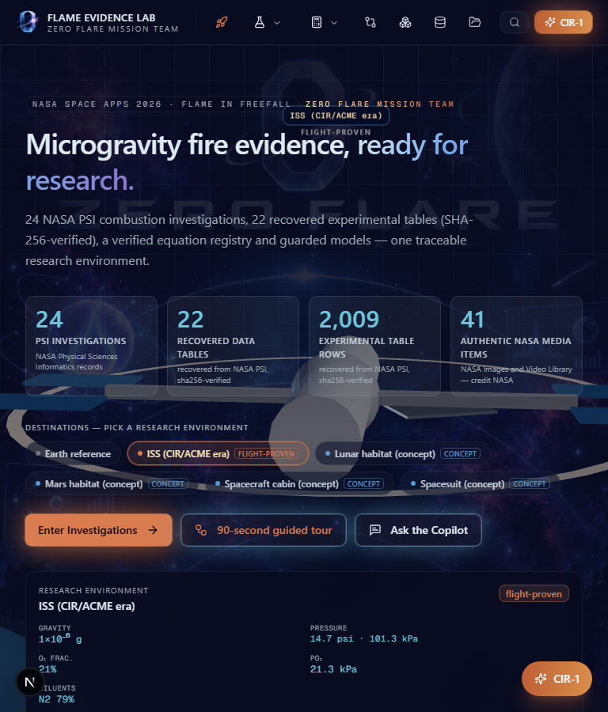 | 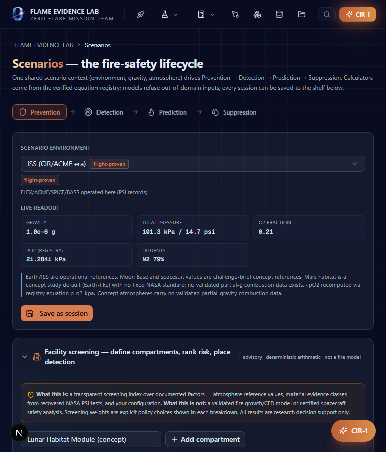 | 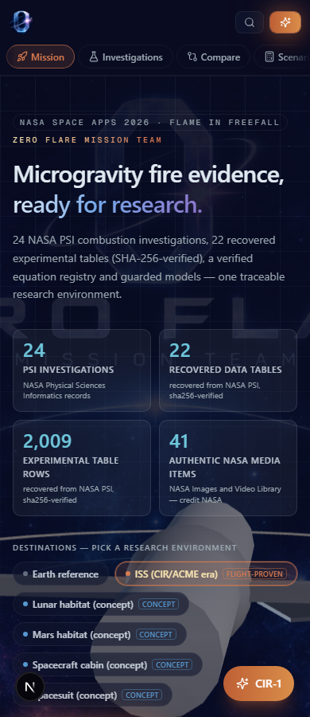 | 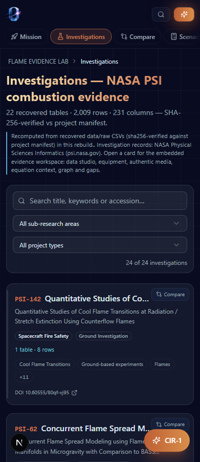 |

## Honesty contract

1. Every number is recomputed from recovered NASA PSI tables (SHA-256-verified against the
   project manifest) or produced by the verified equation registry (63 equations, 68/68
   reference tests — `GET /api/selftest`).
2. The FLEX droplet-extinction model refuses predictions above 0.02 g — outside its verified
   microgravity domain. No partial-gravity extrapolation is offered.
3. LLM output is orchestration, never measurement: CIR-1's numbers come from deterministic
   tools only, with provenance; a missing LLM degrades honestly instead of improvising.
4. Missing data stays missing: duplicates, blanks and parse failures are counted and shown.
   The 2,393 historical media binaries are NOT recovered — status shown honestly; the platform
   uses authentic NASA Images API media instead.
5. Negative results are preserved and displayed (CFI-G below oxygen-only baseline; SPICE
   regression worse than a fuel-mean baseline). Ingestion never trains a model.
6. The comparability gate refuses cross-study plots/rankings when conditions differ — scientific
   caution is a product feature, not a footnote.

## The 90-second judge journey

Mission → open **PSI-69 FLEX** (real rows, sha256 provenance) → **Compare** with PSI-99 SAFFIRE-II and read the gate's "not directly comparable" verdict → ask **CIR-1** for lunar vs Earth pO₂ (deterministic calculation + citation) → **Scenarios**: lunar habitat facility analysis with partial-gravity caveat → discover the **partial-gravity gap** in the coverage map → save it and export the evidence packet from **My Work**.

## Evidence base (this merged build)

- **24 experimental tables / 2,085 rows / 249 columns** recovered directly from the NASA PSI
  public download endpoint — all 20 present cleaned CSVs byte-identical to the acquisition
  manifest (SHA-256, recomputed 2026-11-15; see docs/data-audit/).
- **24 investigation metadata records** (objectives, approach, hypothesis, impacts, DOI, PI,
  hardware, publications) from the PSI repository API.
- **41 authentic NASA media records** from the NASA Images and Video Library (credit: NASA).
- **63-equation registry (68/68 reference tests)** merged from two version registries; 26 typed
  agent tools; deterministic comparability gate and fire-safety facility engine.
- **FLEX extinction model v2** retrained from recovered data: grouped AUC 0.882
  (historical build recorded 0.875); O2-only baseline 0.818.
- **CFI-G scorer**: spec-preserved coefficients validated on recovered data (146 rows / 131
  positives, exact match with the recorded model card).
- **Official NASA 3D assets**: ISS + Perseverance GLBs, provenance in `public/textures/PROVENANCE.md`.

## Evidence base (this rebuild)

- **24 experimental tables / 2,085 rows / 249 columns** recovered directly from the NASA PSI
  public download endpoint — all 20 present cleaned CSVs byte-identical to the manifest (SHA-256).
- **24 investigation metadata records** (objectives, approach, hypothesis, impacts, DOI, PI,
  hardware, publications) from the PSI repository API.
- **41 authentic NASA media records** from the NASA Images and Video Library (credit: NASA).
- **FLEX extinction model v2** retrained from recovered data: grouped AUC 0.882
  (historical build recorded 0.875); O2-only baseline 0.818.
- **CFI-G scorer**: spec-preserved coefficients validated on recovered data (146 rows / 131
  positives, exact match with the recorded model card).

## Architecture

- Next.js 16 App Router · React 19 · TypeScript 5 · Tailwind CSS 4 · shadcn/ui
- Zustand (view/environment/session state, persisted) · Recharts (real-data charts)
- React Three Fiber + drei (mission journey, apparatus schematics; WebGL fallback + reduced motion)
- z-ai-web-dev-sdk (server-side LLM only — never in the client bundle)
- Prisma with a scientific schema (research sessions, scenario runs, ingest batches/files,
  source records, equation drafts, gap records) on SQLite locally; Postgres is the documented
  deployment target
- Single product route (`/`) with client-side section switching; API routes: `/api/copilot`

## Verification

- `eslint` clean · `tsc --noEmit` 0 errors in `src/` · 54/54 equation reference tests
- Browser-verified at 1440 / 768 / 390 px across all sections (see
  `download/M1-M12_MILESTONE_REPORT.md`)
- Agent behaviour tests: natural small-talk (no forced tools); lunar-gravity FLEX request refused
  with gap citation; chart requests produce real rows with sample size and provenance

## Data pipeline (reproducible)

```bash
python3 scripts/fetch_psi_data.py        # recover PSI tables -> data/raw/ (with ledger)
python3 scripts/fetch_psi_metadata.py    # PSI metadata + NASA media -> data/ingest/
python3 scripts/build_corpus.py          # corpus stats -> src/data/generated/corpus.json
python3 scripts/generate_data_layer.py   # investigations/graph/gaps/findings/atmospheres
python3 scripts/verify_flex_model.py     # FLEX retrain + model card -> models/flex-extinction/v2/
bun scripts/inspect_screenshot.ts   # VLM screenshot inspection (verification aid)
```

See `download/M0_RECONCILIATION_REPORT.md` (what was recovered and verified) and
`download/M1-M12_MILESTONE_REPORT.md` (milestone-by-milestone state and honest limitations).

## Documentation index (docs/)

| Document | Contents |
|---|---|
| `FINAL_VERSION_MERGE_REPORT.md` | The three-version merge: composition, verified state, acceptance journey |
| `GAP_MATRIX.md` | Prioritized gap matrix — every gap with evidence, priority, status |
| `ACQUISITION_AND_INTEGRATION_REPORT.md` | Live PSI acquisition: discovery, downloads, reconciliation, coverage charts, V2 mission migration |
| `MATHEMATICAL_MODELING_AUDIT.md` | 17A Mathematical Model Registry: 11 models, lifecycle statuses, validation evidence, selection engine |
| `SCIENTIFIC_UPGRADE_TECHNICAL_REPORT.md` | V2 design base, deep extraction (216 figures), visualization depth, 3D upgrade, hybrid RAG |
| `CANONICAL_SOURCE_MANIFEST.json` / `CANONICAL_DATA_MANIFEST.json` | SHA-256 identities for every source and derived artifact |
| `SOURCE_CONFLICT_REPORT.md` | Count conflicts across versions, resolved with evidence |
| `VERSION_MERGE_MATRIX.json` | Feature-level merge decisions (KEEP/PORT/MERGE/…) with tests + acceptance |
| `FINAL_ARCHITECTURE_DECISIONS.md` | ADRs 0–12 |
| `DATA_QUALITY_AND_EDA_REPORT.md` | Corpus integrity, EDA capabilities, ingestion verification |
| `EQUATION_AND_VARIABLE_REGISTRY.md` | 63-equation registry + merged additions + variable dictionary |
| `MODEL_CARDS_AND_VALIDATION_REPORT.md` | Honest model statuses (verified / exploratory / negative / absent) + governance |
| `AI_AGENT_AND_RAG_REPORT.md` | CIR-1 contract, 28 tools, hybrid RAG, scientific QA evaluation |
| `KNOWLEDGE_GAP_REPORT.md` | Gap registry + Evidence Coverage Map |
| `UI_UX_AND_ACCESSIBILITY_REVIEW.md` | Verified layout matrix, axe results, contrast fixes |
| `SECURITY_AND_PERFORMANCE_REPORT.md` | Ingestion/media security, rate limits, performance measures |
| `FINAL_TESTING_AND_ACCEPTANCE_REPORT.md` | All gate results per round |
| `SCIENTIFIC_QA_EVALUATION.md` *(generated)* | 12-question evidence-based evaluation output |
| `DEPLOYMENT.md` | Live site, packaging decisions, cloud limitations, redeploy steps |
| `IMPLEMENTATION_CHANGELOG.md` | Round-by-round implementation log |
| `history/` | Prior-round reports (M0 reconciliation, milestone reports) |
